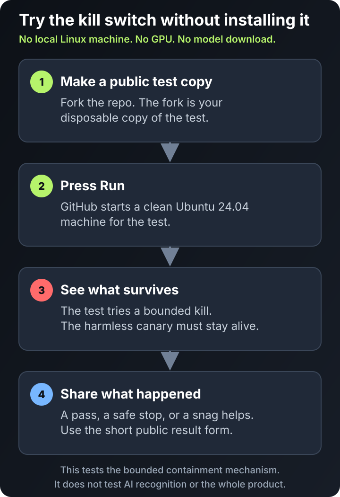

# Try Lumi Eggcracker without installing it

You can test Eggcracker's kill mechanism on a disposable GitHub machine. You
don't need Linux, a GPU, a model download or a local installation.



## Checkout-free source-only observe-first preview (unreleased)

This separate preview runs on Python 3.11 or newer from a downloaded zipapp.
It needs no Git checkout, package installation, or `PYTHONPATH`. Download the
zipapp, its adjacent checksum file, and the synthetic fixture files into one
directory. These links follow the current public `main` branch:

- [Zipapp](https://raw.githubusercontent.com/noqt/Lumi-Eggcracker/main/examples/observe-first/lumi-eggcracker-observe-first.pyz)
- [Zipapp SHA-256 file](https://raw.githubusercontent.com/noqt/Lumi-Eggcracker/main/examples/observe-first/lumi-eggcracker-observe-first.pyz.sha256)
- [Benign fixture](https://raw.githubusercontent.com/noqt/Lumi-Eggcracker/main/examples/observe-first/benign.json)
- [Complete-match fixture](https://raw.githubusercontent.com/noqt/Lumi-Eggcracker/main/examples/observe-first/complete-match.json)
- [Partial-match fixture](https://raw.githubusercontent.com/noqt/Lumi-Eggcracker/main/examples/observe-first/partial-match.json)

On macOS or Linux, download the files and verify the adjacent checksum with
this small Python 3.11+ standard-library verifier:

```sh
mkdir -p observe-first-preview && cd observe-first-preview
curl -fSLO https://raw.githubusercontent.com/noqt/Lumi-Eggcracker/main/examples/observe-first/lumi-eggcracker-observe-first.pyz
curl -fSLO https://raw.githubusercontent.com/noqt/Lumi-Eggcracker/main/examples/observe-first/lumi-eggcracker-observe-first.pyz.sha256
curl -fSLO https://raw.githubusercontent.com/noqt/Lumi-Eggcracker/main/examples/observe-first/benign.json
curl -fSLO https://raw.githubusercontent.com/noqt/Lumi-Eggcracker/main/examples/observe-first/complete-match.json
curl -fSLO https://raw.githubusercontent.com/noqt/Lumi-Eggcracker/main/examples/observe-first/partial-match.json
python3 --version
if ! python3 - <<'PY'
from hashlib import file_digest
from pathlib import Path
import re
import sys

archive_name = "lumi-eggcracker-observe-first.pyz"
checksum_name = "lumi-eggcracker-observe-first.pyz.sha256"
checksum_text = Path(checksum_name).read_text(encoding="utf-8").strip()
match = re.fullmatch(r"([0-9a-f]{64})  " + re.escape(archive_name), checksum_text)
if match is None:
    print("Checksum file format is invalid", file=sys.stderr)
    raise SystemExit(1)

with open(archive_name, "rb") as archive:
    actual_hash = file_digest(archive, "sha256").hexdigest()
if actual_hash != match.group(1):
    print("Zipapp checksum mismatch", file=sys.stderr)
    raise SystemExit(1)
print("Zipapp checksum verified")
PY
then
  echo "Checksum verification failed; stop before running the archive." >&2
  exit 1
fi
```

After verification succeeds, run the downloaded archive:

```sh
python3 lumi-eggcracker-observe-first.pyz benign.json
python3 lumi-eggcracker-observe-first.pyz complete-match.json
python3 lumi-eggcracker-observe-first.pyz partial-match.json
python3 lumi-eggcracker-observe-first.pyz --explain-selection complete-match.json
```

On Windows PowerShell, run the equivalent commands:

```powershell
$previewDir = Join-Path (Get-Location) "observe-first-preview"
New-Item -ItemType Directory -Path $previewDir -Force | Out-Null
Set-Location $previewDir
$baseUrl = "https://raw.githubusercontent.com/noqt/Lumi-Eggcracker/main/examples/observe-first"
Invoke-WebRequest "$baseUrl/lumi-eggcracker-observe-first.pyz" -OutFile "lumi-eggcracker-observe-first.pyz"
Invoke-WebRequest "$baseUrl/lumi-eggcracker-observe-first.pyz.sha256" -OutFile "lumi-eggcracker-observe-first.pyz.sha256"
Invoke-WebRequest "$baseUrl/benign.json" -OutFile "benign.json"
Invoke-WebRequest "$baseUrl/complete-match.json" -OutFile "complete-match.json"
Invoke-WebRequest "$baseUrl/partial-match.json" -OutFile "partial-match.json"
$checksumLine = (Get-Content "lumi-eggcracker-observe-first.pyz.sha256" -Raw).Trim()
$checksumMatch = [regex]::Match($checksumLine, '^([0-9a-f]{64})  lumi-eggcracker-observe-first\.pyz$')
if (-not $checksumMatch.Success) { throw "Checksum file format is invalid" }
$expectedHash = $checksumMatch.Groups[1].Value
$actualHash = (Get-FileHash "lumi-eggcracker-observe-first.pyz" -Algorithm SHA256).Hash.ToLowerInvariant()
if ($actualHash -cne $expectedHash) { throw "Zipapp checksum mismatch" }
python --version
python .\lumi-eggcracker-observe-first.pyz .\benign.json
python .\lumi-eggcracker-observe-first.pyz .\complete-match.json
python .\lumi-eggcracker-observe-first.pyz .\partial-match.json
python .\lumi-eggcracker-observe-first.pyz --explain-selection .\complete-match.json
```

The archive's `SOURCE-MANIFEST.json` records base source commit
`47b822ca5d1dcc753535a7c2fcb74aece7f9b73d` and SHA-256 values for every
included source member. The adjacent checksum detects a changed or incomplete
download; it is not a signature or independent authentication. The preview is
synthetic, quiescent and offline. It reads one bounded JSON fixture, prints a
deterministic `WOULD_ACT` or `NO_COMPLETE_MATCH` result, and performs no live
observation, approval, output-file write, or actuation. The optional
`--explain-selection` flag prints the inert catalogue-selection explanation.
This source preview is unreleased, outside signed v1.0.10, and not
native-qualified. A non-match is not a safety result.

If you already have a source checkout, the same preview can also be run from
its `src` directory without creating the zipapp:

```sh
PYTHONPATH=src python3 -m lumi_eggcracker.observe_first examples/observe-first/benign.json
PYTHONPATH=src python3 -m lumi_eggcracker.observe_first examples/observe-first/complete-match.json
PYTHONPATH=src python3 -m lumi_eggcracker.observe_first examples/observe-first/partial-match.json
PYTHONPATH=src python3 -m lumi_eggcracker.observe_first --explain-selection examples/observe-first/complete-match.json
```

On Windows PowerShell, from the source checkout use:

```powershell
$env:PYTHONPATH = "src"
python -m lumi_eggcracker.observe_first examples/observe-first/benign.json
python -m lumi_eggcracker.observe_first examples/observe-first/complete-match.json
python -m lumi_eggcracker.observe_first examples/observe-first/partial-match.json
python -m lumi_eggcracker.observe_first --explain-selection examples/observe-first/complete-match.json
```

For either entry point, the partial fixture reports catalogue requirements
with supplied and missing evidence. Unknown or wrong-group identifiers are
rejected before normal output. The selection explanation names complete
catalogue profiles and the maintained first-complete selection rule only; it
does not establish true workload or framework identity, topology, provenance,
safety, native qualification or authorization. Nothing in this source-preview
usage claims publication.

## Checkout-free GGUF file-evidence preview (unreleased)

This is a separate Python 3.11+ source-only zipapp for inspecting one explicitly
selected GGUF file. It needs no Git checkout, package installation, or
`PYTHONPATH`. Download both files into the same directory from public `main`:

- [GGUF file-observer zipapp](https://raw.githubusercontent.com/noqt/Lumi-Eggcracker/main/examples/gguf-file/lumi-eggcracker-gguf-file.pyz)
- [GGUF file-observer SHA-256 file](https://raw.githubusercontent.com/noqt/Lumi-Eggcracker/main/examples/gguf-file/lumi-eggcracker-gguf-file.pyz.sha256)

On macOS or Linux, download and verify before running. The verification block
exits without running the archive if the checksum line or downloaded bytes do
not match:

```sh
mkdir -p gguf-file-preview && cd gguf-file-preview
curl -fSLO https://raw.githubusercontent.com/noqt/Lumi-Eggcracker/main/examples/gguf-file/lumi-eggcracker-gguf-file.pyz
curl -fSLO https://raw.githubusercontent.com/noqt/Lumi-Eggcracker/main/examples/gguf-file/lumi-eggcracker-gguf-file.pyz.sha256
python3 -c "import hashlib,pathlib,re,sys; n='lumi-eggcracker-gguf-file.pyz'; t=pathlib.Path(n+'.sha256').read_text(encoding='ascii').strip(); m=re.fullmatch(r'([0-9a-f]{64})  '+re.escape(n),t); a=hashlib.sha256(pathlib.Path(n).read_bytes()).hexdigest(); ok=m is not None and a==m.group(1); print('Zipapp checksum verified' if ok else 'Zipapp checksum mismatch',file=sys.stdout if ok else sys.stderr); raise SystemExit(0 if ok else 1)" || { echo "Checksum verification failed; stop before running the archive." >&2; exit 1; }
python3 lumi-eggcracker-gguf-file.pyz path/to/model.gguf
```

On Windows PowerShell, use the equivalent fail-closed sequence:

```powershell
$previewDir = Join-Path (Get-Location) "gguf-file-preview"
New-Item -ItemType Directory -Path $previewDir -Force | Out-Null
Set-Location $previewDir
$baseUrl = "https://raw.githubusercontent.com/noqt/Lumi-Eggcracker/main/examples/gguf-file"
Invoke-WebRequest "$baseUrl/lumi-eggcracker-gguf-file.pyz" -OutFile "lumi-eggcracker-gguf-file.pyz"
Invoke-WebRequest "$baseUrl/lumi-eggcracker-gguf-file.pyz.sha256" -OutFile "lumi-eggcracker-gguf-file.pyz.sha256"
python -c "import hashlib,pathlib,re,sys; n='lumi-eggcracker-gguf-file.pyz'; t=pathlib.Path(n+'.sha256').read_text(encoding='ascii').strip(); m=re.fullmatch(r'([0-9a-f]{64})  '+re.escape(n),t); a=hashlib.sha256(pathlib.Path(n).read_bytes()).hexdigest(); ok=m is not None and a==m.group(1); print('Zipapp checksum verified' if ok else 'Zipapp checksum mismatch',file=sys.stdout if ok else sys.stderr); raise SystemExit(0 if ok else 1)"
if ($LASTEXITCODE -ne 0) { throw "Checksum verification failed; stop before running the archive." }
python .\lumi-eggcracker-gguf-file.pyz path\to\model.gguf
```

Successful output is `FILE_EVIDENCE_ONLY`. It reports a GGUF version, size
bucket, and a SHA-256 digest of only the inspected prefix; it is not a full-file
hash. Runtime and topology evidence remain empty, and file content alone does
not complete an Eggcracker profile. The observer reads only the selected
bounded regular file and performs no actuation.
Refusals from the downloaded archive use the same fixed `rc=2` contract
described in the source-checkout section: pre-output refusals leave stdout
empty, and selected paths or exception details are not reported. A failure
after output has started is not presented as a rollback.

This source-only preview is unreleased and outside signed v1.0.10 and v1.0.11.
It is not native-qualified and does not establish workload identity,
provenance, approval, safety, containment, or runtime/topology evidence. The
adjacent archive checksum detects changed or incomplete download bytes; it is
not a signature or independent authentication.

## Inspect one selected GGUF file from a source checkout

With a current source checkout and Python 3.11 or newer, you can ask the
content-only file observer to inspect one explicitly selected, bounded GGUF
file. No package installation is required:

```sh
PYTHONPATH=src python3 -m lumi_eggcracker.gguf_file_observe path/to/model.gguf
```

On Windows PowerShell, from the source checkout use:

```powershell
$env:PYTHONPATH = "src"
python -m lumi_eggcracker.gguf_file_observe path\to\model.gguf
```

For this source-checkout observer, a refusal exits with status `2` and writes
one fixed ASCII token to stderr: `USAGE`,
`FILE_UNAVAILABLE_OR_UNSUPPORTED_TYPE`, `NOT_USABLE_GGUF`,
`FILE_CHANGED_DURING_OBSERVATION`, or `INTERNAL_REPORT_FAILURE`. The selected
path and exception details are never included. Stdout is empty when refusal
happens before report output starts; if output has already started and then
fails, the observer does not claim that partial output was rolled back.
An initially accessible regular file shorter than the fixed minimum is
`NOT_USABLE_GGUF`; an oversized selection remains
`FILE_UNAVAILABLE_OR_UNSUPPORTED_TYPE`. Parser faults are categorized only
after the safe post-state checks, so an evidenced mutation wins.

### Act on a refusal token without sharing file details

Every status `2` result remains a refusal, not job completion.

Copy only one exact recognized refusal token. Never share filename, local path, model bytes, raw stderr, command output, partial stdout or exception text.

A tool commit or archive digest identifies the tool only; it does not identify
or establish any property of the selected file.

- `USAGE` — Run again with exactly one local file argument. Do not paste or transmit the argument.
- `FILE_UNAVAILABLE_OR_UNSUPPORTED_TYPE` — Do not bypass the refusal. Select only a readable ordinary local file that is not a link/reparse point, directory/device, missing, oversized or otherwise unsupported. The token intentionally collapses these cases and cannot identify the subtype; stop if the distinction cannot be made locally.
- `NOT_USABLE_GGUF` — Do not treat this as proof of universal invalidity or loader incompatibility. Confirm intended format and, where an independently trusted expected digest exists, verify the full file through an appropriate full-file mechanism before deciding whether to reacquire it. A matching trusted full-file digest establishes byte equality only; it does not establish GGUF usability, loader compatibility, safety, provenance or authentication. The bounded preview cannot authenticate or validate the whole file.
- `FILE_CHANGED_DURING_OBSERVATION` — Discard the observation. Wait until any download, sync or writer has finished. Then, if permitted, make a stable ordinary-file copy and rerun. Do not act on or share partial output.
- `INTERNAL_REPORT_FAILURE` — Treat this as a tool/reporting failure, not evidence against the selected file. Stop; retain only the exact token plus the exact tool commit or archive digest for a permissioned support report. Keep the file and path private.

Successful output reports only facts read from that selected file: the GGUF
version and content evidence ID, a size bucket, the number of inspected prefix
bytes, and a SHA-256 digest whose scope is explicitly `first_prefix_only`.
Runtime and topology evidence remain empty, and `complete_profiles` remains
empty because file content alone does not complete an Eggcracker profile. The
observer does not actuate, identify a running workload, or prove provenance,
safety, containment, native qualification, or full-file identity.

This source-checkout utility is not included in the existing synthetic
`lumi-eggcracker-observe-first.pyz` archive. That archive and its checksum,
fixtures, commands, and hosted-proof guidance above remain a separate
synthetic preview.

## Start it with GitHub CLI

If you already use the authenticated [GitHub CLI](https://cli.github.com/), a
fail-closed helper can create or reuse only your exact Lumi Eggcracker fork,
enable the reviewed workflow and dispatch it. On macOS or Linux, copy and paste
this block to make a temporary shallow checkout and start the helper without
navigating the repository or Actions UI:

```sh
proof_dir="$(mktemp -d)/Lumi-Eggcracker" &&
gh repo clone noqt/Lumi-Eggcracker "$proof_dir" -- --depth=1 &&
python3 "$proof_dir/scripts/start_hosted_proof.py" \
  --i-understand-this-kills-a-test-tree \
  --wait
```

On Windows PowerShell, use the equivalent block:

```powershell
$proofDir = Join-Path ([IO.Path]::GetTempPath()) (
  "Lumi-Eggcracker-" + [guid]::NewGuid().ToString("N")
)
gh repo clone noqt/Lumi-Eggcracker $proofDir -- --depth=1
if ($LASTEXITCODE -ne 0) { throw "Clone failed" }
python (Join-Path $proofDir "scripts\start_hosted_proof.py") `
  --i-understand-this-kills-a-test-tree `
  --wait
```

The helper prints the exact workflow-run URL when GitHub returns it directly or
the helper can uniquely correlate it to this dispatch. With `--wait`, it follows
that exact run through completion and ends with an explicit `PASS` or `FAIL` and
the exact run URL. Successful runs stay concise; add `--show-log` when you also
want the bounded public workflow log in the terminal. Failed runs print that log
automatically for diagnosis. If exact correlation is unavailable, it does not
guess; it leaves the fork's workflow page for manual inspection. Without
`--wait`, it prints separate copyable watch and log commands. The run URL remains
available for the same result in GitHub's interface.

### Resume the same run and save its receipt

If the starter's wait was interrupted or timed out, do not start another proof.
Keep the exact run URL it printed. In your existing source checkout, replace
`OWNER` and `RUN_ID` below with that run's owner and numeric ID:

```sh
python3 scripts/start_hosted_proof.py --resume https://github.com/OWNER/Lumi-Eggcracker/actions/runs/RUN_ID --receipt receipt.json
python3 scripts/validate_hosted_proof_receipt.py receipt.json
```

On Windows use `python` instead of `python3`. From the temporary checkout above,
first change into `"$proof_dir"` (macOS/Linux) or `$proofDir` (PowerShell).
Resume performs read-only GitHub requests: no dispatch, workflow enablement,
fork creation or sync, and no acknowledgement is needed. It does not wait:
if the run is still incomplete, retry the same command after it completes.
Omit `--receipt receipt.json` to verify without creating a file.

Only a completed successful run in the public canonical repository or its
direct fork, with the exact currently reviewed workflow at its run commit,
can export. It independently checks the seven reviewed probe-source Git blobs
and refuses import-shadowing source paths before retrieving logs. The helper
requires one valid success receipt matching that commit
and the workflow's qualified source digest. Older or changed workflows,
ambiguous receipts and failed runs are refused, even if JSON structure is valid.
No raw log or receipt values are printed. The output must be a new file:
existing files and symlinks are not overwritten; symlink/reparse parent
directories are refused. Choose a trusted directory that is not being renamed
or modified concurrently. On a write error a partial new
file may remain; choose a new path to retry. No files are automatically removed.
These GitHub identity and schema checks are not independent authentication,
new containment qualification or evidence of independent adoption.

### Or use the GitHub interface

1. [Fork Lumi Eggcracker](https://github.com/noqt/Lumi-Eggcracker/fork).
2. In your fork, open **Actions** and enable workflows if GitHub asks.
3. Open **Containment probe (manual disposable runner)**, choose **Run
   workflow**, tick the acknowledgement and run it on the default branch.

The temporary source checkout remains at the printed operating-system temp
location after the run. If you already have a current public source checkout,
run the helper directly instead:

```sh
python3 scripts/start_hosted_proof.py \
  --i-understand-this-kills-a-test-tree \
  --wait
```

The acknowledgement is mandatory. The helper refuses a same-named repository
that is not a fork of `noqt/Lumi-Eggcracker`. The helper itself never executes
through a shell; the copy-paste setup above uses your shell only to create the
temporary public-source checkout and start the helper.
It also refuses to dispatch if the fork's workflow differs from the reviewed
workflow. If an existing fork is simply stale, rerun the helper with
`--sync-fork` to explicitly permit a fast-forward-only GitHub sync from the
exact upstream. The helper never adds `--force`: after syncing, it revalidates
the fork identity, default branch and reviewed workflow blob, and dispatches
nothing if any check fails. It never requests or prints a token; authenticated
`gh` handles its own credentials. If the bounded run lookup is unavailable or
ambiguous, it prints the fork's workflow page instead. This starts the same
disposable hosted proof described above; it does not install Eggcracker or test
workload recognition.

The proof creates a harmless two-process test tree, kills it with Eggcracker's
containment mechanism and checks that an unrelated canary survives. A passing
run prints a JSON receipt with `"result":"TERMINATED"`,
`"target_survivors":0` and `"canary_survived":true`, followed by
`FORK_PROBE_RESULT=PASS`.

Automations can validate that current PASS receipt, or a redacted refusal or
failure receipt, against the versioned [hosted-proof receipt v1 schema](schemas/hosted-proof-receipt-v1.schema.json).
The [synthetic success example](schemas/examples/hosted-proof-receipt-v1-success.json)
is a copy-ready shape for integration tests; its all-zero source identities are
placeholders and must never be treated as evidence of a run.
Schema validation checks structure only. It does not authenticate the run,
source commit or tree, workflow or host, and it does not claim that the host is
suitable for production or that Eggcracker detected a real workload. The v1
file remains compatible; an incompatible contract uses a new versioned path.

After exporting with `--resume --receipt` above (or manually saving the single
JSON receipt object as `receipt.json`), the repository's
zero-dependency validator gives automation an exact local exit status without
uploading or echoing the receipt:

```sh
python3 scripts/validate_hosted_proof_receipt.py receipt.json
```

Exit status `0` means the object matches exactly one current v1 shape; status
`1` means it does not. This validates structure only and does not turn a
synthetic example into run evidence or authenticate a real receipt.

A partner repository can call the same local validator as a pinned composite
action:

```yaml
- uses: noqt/Lumi-Eggcracker/actions/validate-hosted-proof-receipt@<40-character-commit-sha>
  with:
    receipt: receipt.json
```

Replace the placeholder with an immutable commit containing the action. The
receipt path is passed as an environment value rather than interpolated into a
shell command. The action uploads nothing and prints only the bounded validator
result; it still validates structure rather than authenticating a run.

For a complete read-only job, a partner repository can instead call the reusable
workflow with the same local receipt path:

```yaml
jobs:
  validate-eggcracker-receipt:
    uses: noqt/Lumi-Eggcracker/.github/workflows/validate-hosted-proof-receipt.yml@<40-character-commit-sha>
    with:
      receipt: receipt.json
```

Pin the workflow to an immutable commit containing it. The job checks out the
caller repository with persisted credentials disabled, then invokes the pinned
local validator action. It requests read-only contents permission, exposes no
outputs or secrets and uploads no receipt.

If it passes, returns a redacted failure or gives you confusing friction,
[send the public run](https://github.com/noqt/Lumi-Eggcracker/issues/new?template=hosted_probe_result.yml).
The short form asks for the workflow URL and what happened. That is useful
evidence either way.

noqt will acknowledge a complete public hosted-proof report within two
Australian business days. That acknowledgement is not a promise of a fix,
release, private support, or product qualification.

This hosted proof tests only the bounded kill mechanism. It does not install
Eggcracker, recognise an AI workload or prove the whole product. The workflow
is designed for GitHub's disposable Ubuntu 24.04 runner; don't adapt it to a
self-hosted machine.

[Read how Eggcracker works and where its current boundary sits](README.md).
